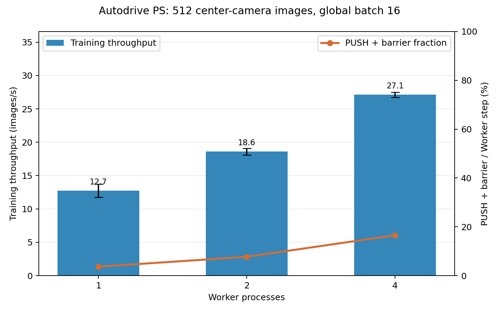
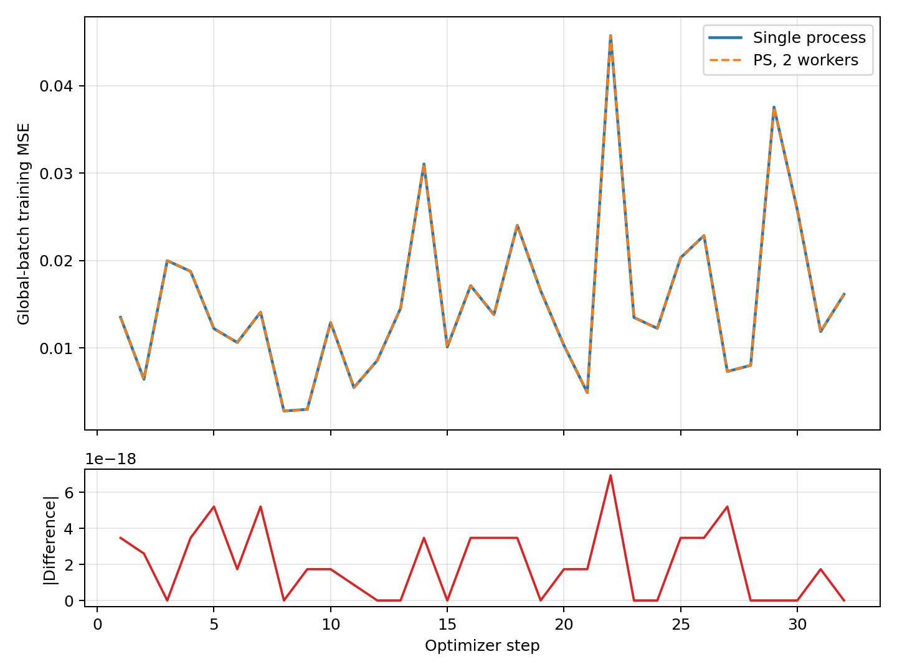
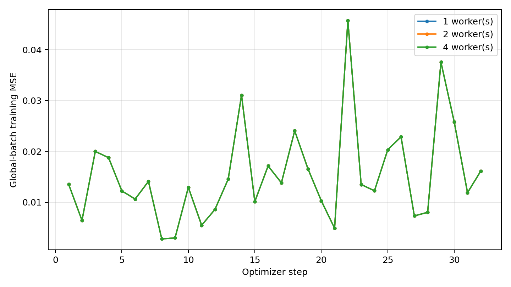

# M2 同步 PS 自动驾驶小车数据集测试报告

测试日期：2026-11-08。本报告评估 EnNeuro **单机 CPU 多进程同步 Parameter Server（PS）** 在本学期新增的小车图像数据上的训练表现。1/2/4 Worker 指同一台机器上的进程数，用于模拟设备数量，不是 1/2/4 台独立设备。没有驾驶模拟器，本次只能测离线监督训练，不能评价车辆实际行驶表现。

## 数据、模型与实验设置

| 项目 | 本次设置 |
| --- | --- |
| 数据来源 | `tests/testdata/data/driving_log.csv` 与 `IMG/`：8,036 行记录、24,108 张图像，分别是中心/左/右相机；所有 CSV 图片路径存在 |
| 实际训练样本 | 从 8,036 行记录中等间距固定选取 **512 行**，每行只读取中心相机图像及 `steering` 转向角；1 epoch，每组总共处理 512 张图像 |
| 预处理 | RGB，双线性缩放到宽 160 × 高 120，转为 `(3,120,160)` 的 `float32`，像素除以 255；转向角为 `(1,)` 的 `float32` |
| 模型 | `PSAutoDriveNet`，参考项目 `serving.AutoDriveNet` 的五层卷积（通道数 24/36/48/64/64）和四层全连接（100/50/10/1）回归头，约 80.3 万参数；为匹配 PS，去掉未同步的 BatchNorm，并在构造时初始化全部参数。因此这是**PS 兼容变体**，不是原模型原样运行 |
| 训练 | 转向角均方误差（MSE）、SGD 学习率 0.01、seed 42、不打乱数据、全局 batch 16，共 32 次 PS 更新；Worker=1/2/4 时本地 batch 分别为 16/8/4 |
| 重复与环境 | 每种 Worker 数独立运行 3 次；Windows、`paddle30` Conda 环境、CPU；`OMP_NUM_THREADS=1`、`OPENBLAS_NUM_THREADS=1`、`MKL_NUM_THREADS=1` |

用中心相机是为了避免给左、右相机图片直接套用中心相机的转向角。所有 Worker 处理的是同一批选定样本、同一全局 batch 序列及同一初始参数。项目现有数据目录被 `.gitignore` 排除；复现时需自行准备同一份 CSV 与图片。

## 指标口径与实测结果

**训练吞吐量**＝512 张图像 ÷ 首个 Worker 开始第一个训练 step 至最后一个 Worker 结束最后一个 step 的墙钟时间，包含逐 batch JPEG 解码/缩放、前反向计算、梯度传输、PS 更新及同步等待；不含 Windows 进程启动、构造模型、读取 CSV 和首次参数拉取。**端到端吞吐量**另包含这些准备与结束开销。**通信与屏障占比**＝所有 Worker 的 `PUSH` 往返耗时之和 ÷ 所有 Worker step 耗时之和；`PUSH` 包含序列化、传输、等待其他 Worker、PS 更新与接收新参数，**不是纯网络耗时**。原始逐次数据见 [results.csv](M2_AutoDrive_PS结果/results.csv)。

| Worker 数 | 训练吞吐量（张/秒） | 相对 1 Worker | 通信与屏障占比 | 端到端吞吐量（张/秒） | 平均训练耗时（秒） |
| ---: | ---: | ---: | ---: | ---: | ---: |
| 1 | 12.75 ± 1.00 | 1.00× | 3.67% ± 0.19% | 10.90 ± 0.68 | 40.34 |
| 2 | 18.60 ± 0.50 | 1.46× | 7.71% ± 0.29% | 15.28 ± 0.43 | 27.54 |
| 4 | 27.11 ± 0.38 | 2.13× | 16.55% ± 0.45% | 20.48 ± 0.25 | 18.89 |

表内为 3 次运行的均值 ± 样本标准差。下图用**柱状图**表示训练吞吐量，误差线是样本标准差；同一张图中的**折线图**表示通信与屏障占比，使用右侧百分比坐标轴。



## M2-08：单进程与双 Worker 的多步 loss 等价性

为了证明 PS 聚合后算的是同一训练过程，另做**单进程全局 batch**与**同步 PS 双 Worker**对照。两者使用同一批 512 张图片、同一初始参数和 seed=42、同一顺序、同一 SGD 学习率 0.01，均运行 1 epoch、全局 batch 16、共 32 次更新。单进程每步直接计算 16 张图；PS 的两个 Worker 各算 8 张，按样本数加权汇总**更新前**的局部 MSE，得到同口径的全局 batch MSE。逐 step 比较后，再逐参数比较训练结束的模型。

| 等价性指标 | 实测值 |
| --- | ---: |
| 对齐的更新次数 | 32 / 32 |
| 每步 loss 最大绝对差 | 6.94 × 10⁻¹⁸ |
| 每步 loss 平均绝对差 | 2.01 × 10⁻¹⁸ |
| 最终参数最大绝对差 | 2.78 × 10⁻¹⁷ |

下面摘录 5 个 step；[equivalence_loss.csv](M2_AutoDrive_PS结果/equivalence_loss.csv) 保存**全部 32 步**的单进程 MSE、双 Worker PS MSE 和绝对差。

| Step | 单进程全局 batch MSE | 2 Worker PS 全局 batch MSE | 绝对差 |
| ---: | ---: | ---: | ---: |
| 1 | 0.013509663611072791 | 0.013509663611072788 | 3.47 × 10⁻¹⁸ |
| 8 | 0.002788580822198201 | 0.002788580822198201 | 0 |
| 16 | 0.017134446947049645 | 0.017134446947049648 | 3.47 × 10⁻¹⁸ |
| 24 | 0.012250321604016578 | 0.012250321604016578 | 0 |
| 32 | 0.016141913398900712 | 0.016141913398900712 | 0 |



上半图的两条 loss 曲线重合，下半图单独放大展示**每一步绝对差**。误差仅在浮点运算精度量级，最终参数也一致，说明这套确定性配置下的数据分片、按样本数聚合梯度和 PS 更新复现了单进程计算。每步使用不同图片，MSE 会明显上下波动；这项测试证明的是**计算等价性**，不是模型已收敛或转向角预测准确。

## 趋势与瓶颈分析

### 计算并行带来提速，但效率逐渐下降

**实测：**从 1 到 2、4 Worker，平均训练耗时由 40.34 秒降至 27.54、18.89 秒，吞吐量增加约 **46%** 和 **113%**。每步全局 batch 不变，而本地 batch 从 16 缩到 8、4；图像解码/缩放和五层卷积可以在多个进程中并行完成，因此新增进程在当前负载下带来实质收益。以理想线性加速为参照，2 Worker 的加速效率约为 73%，4 Worker 约为 53%，说明**进程数增加时边际收益在下降**。这是单机 CPU 实测，不能推断多台设备上的加速效率。

### 参数传输和同步开销也随 Worker 数增长

按所有 Worker 汇总，每次运行的发送数据量约为 **196 / 392 / 784 MiB**，接收量约为 **202 / 404 / 808 MiB**（分别对应 1/2/4 Worker，包含首次参数拉取）。同一轮训练的总样本数及 32 次 PS 更新不变，但每个 Worker 每步仍要上传完整梯度、接收完整参数；因此总字节数近似随 Worker 数线性增长。`PUSH` 与屏障占比同步从 **3.67% → 7.71% → 16.55%**。目前并行计算的收益仍更大，所以 4 Worker 最快；若继续加进程，传输、等待和同机资源竞争可能抵消收益，**本次没有测 8 Worker，无法确定拐点**。

这里的占比并非纯网络时间：`PUSH` 往返还包括 PS 等待、聚合更新和回传参数；分母是所有 Worker 的 step 耗时之和，也不是墙钟时间。当前没有独立的 PS CPU、磁盘吞吐、纯 socket 传输及等待时间指标，所以上述瓶颈是由字节数和时间趋势支持的**合理解释**，不能把减速精确归因于某个部件。

### 端到端时间与 MNIST 实验为何不同

三组平均端到端耗时约为 **47.08 / 33.53 / 25.00 秒**，均比对应训练时间多约 6～7 秒。Windows `spawn`、构造模型、读取 CSV、首次拉取参数和结束任务等非训练开销使端到端吞吐量低于训练吞吐量；任务变长后这些开销占比下降。此前 MNIST + LeNet 的短任务在 4 Worker 时变慢，而本次图像模型在 4 Worker 时仍加速。两次实验同时改变了模型计算量、图片读取方式、参数量、batch 和数据量，**不能只把趋势差异归因于换了数据集**。

## 1/2/4 Worker 的训练轨迹一致性

监控日志记录每个 Worker 更新前的局部 batch MSE；每一步按 Worker 处理样本数加权平均，得到该步的**全局 batch 训练 MSE**。下图绘制了三组各 3 次运行的逐 step 均值；原始逐次数据见 [loss_curves.csv](M2_AutoDrive_PS结果/loss_curves.csv)。



32 个 step 上，1/2/4 Worker 的 loss 曲线几乎完全重合；同一步跨所有 Worker 数和重复运行的最大差约为 **6.94×10⁻¹⁸**。这表明本次速度对比是在几乎相同的优化轨迹上进行的，避免了“某组少算或用了不同数据”造成的虚假提速。它与上节“单进程 vs 2 Worker”的对照是两个不同检查：这里比较不同 Worker 数的 PS 作业，上节还比较了单进程并核对最终参数。曲线本身没有呈现稳定下降，不能据此声称模型已收敛；尚无独立验证集 MAE/MSE，不能评价驾驶预测质量。

## 数据量增大时的预期与验证方法

**以下是预测，尚未在全量 8,036 行上实测。**如果模型、图片尺寸、全局 batch 16 和 Worker 数保持不变，样本从 512 张增至 2,048 张，PS 更新次数会从 32 增至 128；用全量 8,036 张且沿用默认 `drop_last=True` 时，预计进行 **502 次更新、处理 8,032 张**，最后不足 16 张的 4 张被丢弃。每一步传输的是同一个模型的梯度和参数，单步报文大小基本不随总样本数变化。因此**仅增加样本总数不会自动降低每步通信占比**；训练阶段每秒处理的图片数若数据管线和 CPU 状态稳定，可能保持相近量级，而总训练时间和总传输字节会随 step 数增加。

端到端吞吐量可能因固定启动成本被更多 step 摊薄而更接近训练吞吐量。不过图片都在磁盘上逐张解码，长任务可能更明显地受到 I/O、文件系统缓存、内存或 CPU 竞争影响，1/2/4 Worker 的实际排序仍需重跑确认。若改为增大全局 batch，每次参数更新前的计算量增加、报文大小基本不变，通信占比**可能**下降；但 batch 改变会影响优化过程，应在每一组 Worker 对照内固定 batch，另做 batch 大小消融。

下一轮建议分别用 512、2,048、8,036 条记录做 1/2/4 Worker，每组至少重复 3 次；固定数据顺序和参数初始化，逐项记录训练/端到端吞吐量、总耗时、每步 `PUSH` 耗时分布、总字节数、PS CPU 与磁盘读取时间。全量实验须明确最后 4 张的处理策略。若目标是预测质量，还应先按连续驾驶片段或时间段划分训练/验证/测试数据，避免相邻画面泄漏，并报告验证集 MAE/MSE；转向角为 0 的记录占 8,036 条中的 4,361 条（约 54%），需要检查模型是否偏向直行。

## 同步 PS 与异步 PS：当前实现及预期

当前是**同步 BSP**：所有 Worker 在一个 step 使用同一参数版本，各自计算局部梯度；PS 收齐后按样本数加权、只更新一次，再把新参数发回。快 Worker 需要等慢 Worker，换来与单进程全局 batch 清晰可比的更新语义。上面的 32 步 MSE 与参数等价性就是在这一条件下测得的。

**异步 PS 尚未实现，下面仅是预期。**异步方式通常在收到某个 Worker 的梯度后就更新，不等待其他 Worker；当 Worker 速度不一致时可能减少空等并提高样本吞吐量。但当前 4 Worker 的 `PUSH` 与屏障占比约 16.55%，且其中还有传输和 PS 更新，不能把这全部当作异步可消除的等待时间；因此不能承诺异步一定更快。异步 Worker 可能基于旧模型计算梯度，产生 *staleness*；更新到达顺序也不固定，loss 轨迹和最终参数不再需要与同步模式逐步重合，预测误差甚至可能变差。

比较同步和异步时，不能只看“每秒更新次数”：同步 4 Worker 每处理一个全局 batch 16 张更新一次，而朴素异步可能每收到一个 4 张的局部梯度就更新一次；相同样本数对应不同更新次数。后续若实现异步，应同时画**已处理样本数**和**墙钟时间**为横轴的验证集 MAE/MSE 曲线，记录训练吞吐量、更新次数、梯度版本差分布及 PS 负载，并检查学习率对收敛的影响。

## 复现方法与实验边界

在项目 `code` 目录、激活 `paddle30` 后运行：

```powershell
cd D:\Python_Code\Enneuro-Project\code
conda activate paddle30
$env:OMP_NUM_THREADS = '1'
$env:OPENBLAS_NUM_THREADS = '1'
$env:MKL_NUM_THREADS = '1'
python -m unittest discover -s tests -p test_distributed_autodrive.py -v
python -m eneuro.distributed.benchmark --dataset autodrive --samples 512 --batch-size 16 --epochs 1 --workers 1 2 4 --repeats 3 --timeout-s 120 --output metrics/autodrive-ps-512
python -m eneuro.distributed.autodrive_equivalence --samples 512 --batch-size 16 --timeout-s 120
```

本报告的性能实验是 512 张中心相机图像、单机 CPU、每组 3 次重复；等价性实验为同一 512 张图像上的单次 32 步对照。新增的 2 项小车数据自动化测试和原有 PS 测试共 11 项通过。上述数值不代表全量数据、左右相机、独立设备或异步 PS 的实测结果；所用 `PSAutoDriveNet` 也明确区别于含 BatchNorm 的原始 `AutoDriveNet`。
