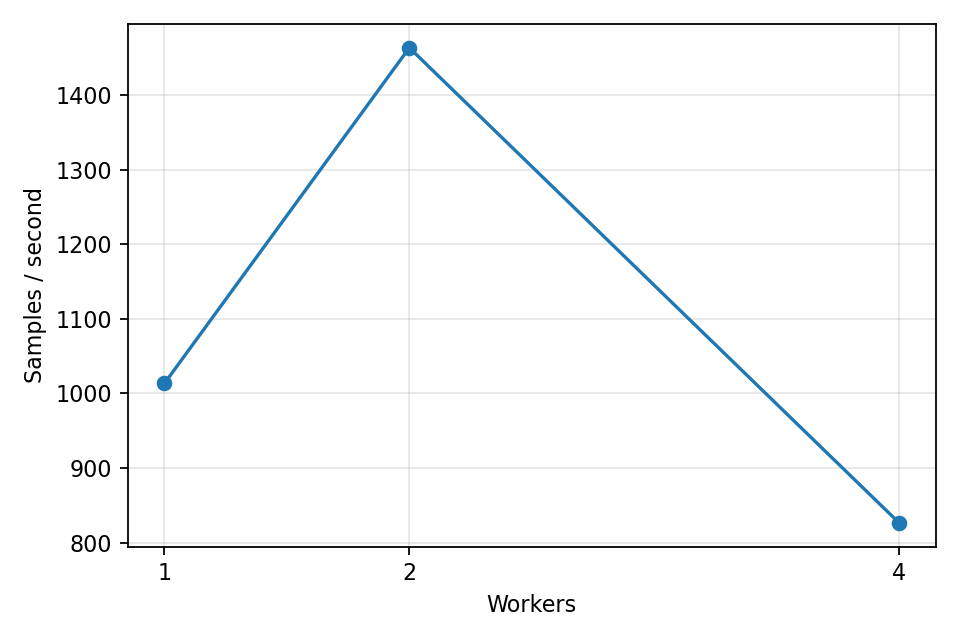
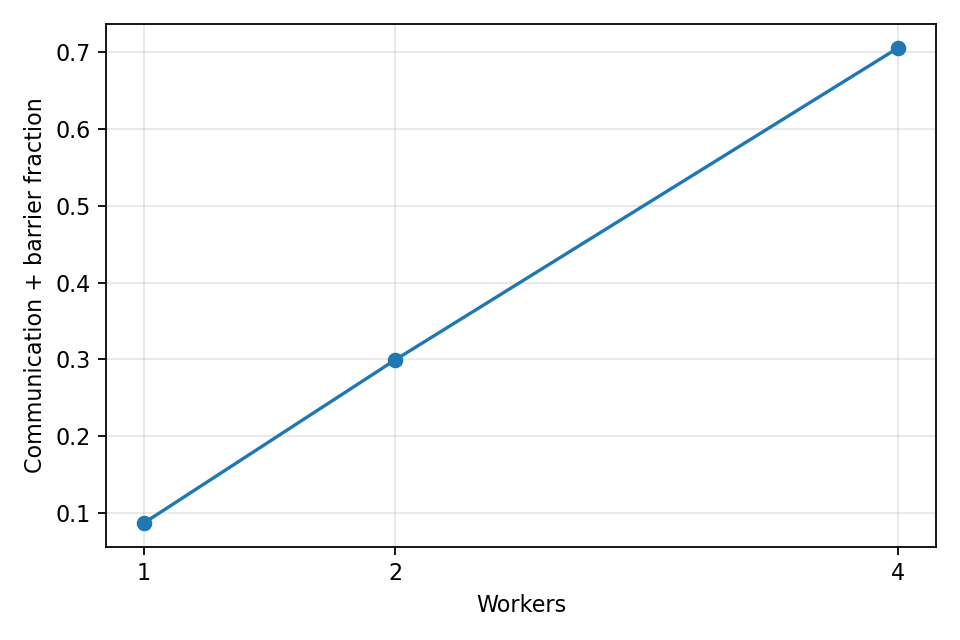
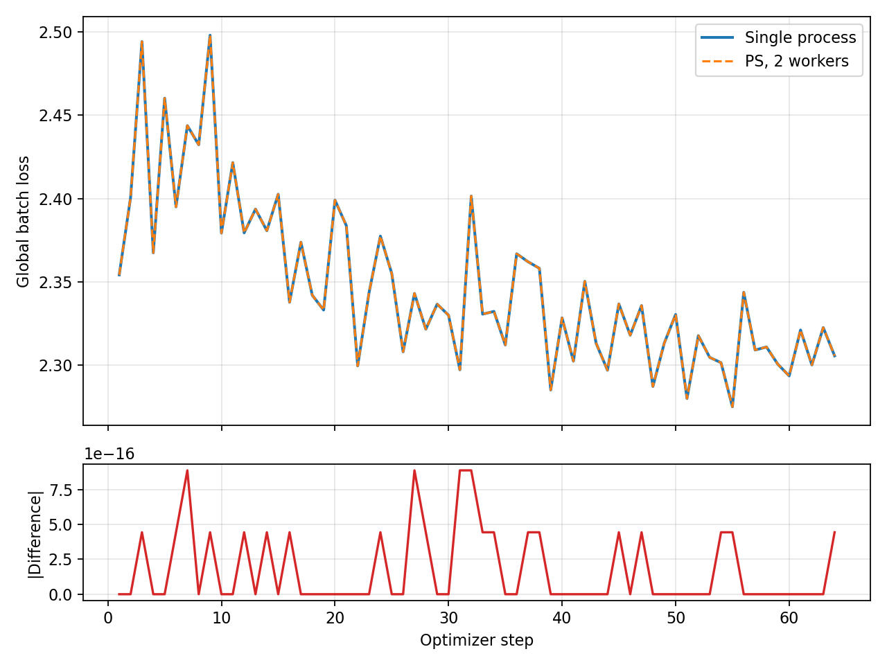

# M2 参数服务器分布式训练测试报告（MNIST）

测试日期：2026-11-07。测试对象为 EnNeuro 单机多进程同步 Parameter Server（PS）：Worker 计算梯度，PS 收齐同一步全部 Worker 梯度后聚合并更新一次参数。这里的 1/2/4 表示**同一台机器上的 Worker 进程数**，用于模拟设备数量，不代表使用了 1/2/4 台真实设备。

## 实验设置

| 项目 | 设置 |
| --- | --- |
| 数据 | 仓库 `tests/testdata/MNIST_data/mnist.pkl` 的训练集；固定取前 1,024 / 60,000 条，像素归一化到 `[0,1]` |
| 模型 | LeNet：Conv(1→6, 5×5) → Pool → Conv(6→16, 5×5) → Pool → FC(256→120→84→10)。沿用项目已有 LeNet 层结构，改为参数在构造时全部初始化以适配 PS |
| 训练 | 交叉熵、SGD（学习率 0.01）、1 epoch、全局 batch 64、共 16 次 PS 更新 |
| 对照 | Worker=1、2、4；各组使用相同样本、初始 seed=42、全局 batch、数据顺序和更新次数；每组重复 3 次 |
| 环境 | Windows、`paddle30` Conda 环境、CPU；`OMP_NUM_THREADS=1`、`OPENBLAS_NUM_THREADS=1`、`MKL_NUM_THREADS=1` |

## 指标口径

- **训练吞吐量**＝实际处理样本数 ÷ 首个训练 step 开始至最后一个 step 结束的时间。它包含梯度传输、PS 更新和同步等待；不含进程启动、初始参数拉取及 MNIST 加载。数值越大，表示稳定训练阶段处理样本越快。
- **端到端作业吞吐量**＝实际处理样本数 ÷ 从启动任务到任务结束的总时间。它反映短任务的实际等待时间，也受 Windows `spawn` 创建进程、各进程加载模型和数据等固定开销影响。
- **通信与屏障占比**＝所有 Worker 的 `PUSH` 往返耗时之和 ÷ 所有 Worker 的 step 耗时之和。`PUSH` 往返包含序列化、传输、在 PS 上等待其他 Worker、参数更新及接收新参数，**不是纯网络时间，也不是独立测得的屏障时间**。两个求和都是 Worker 累计时间，不等于作业墙钟时间。

全局 batch 固定为 64，故每个 step 中每个 Worker 处理的样本数分别为 64、32、16；三组对照的总样本数与 PS 更新次数相同。这使吞吐量差异主要反映并行计算收益与额外开销的权衡。

表中的 1 Worker 仍然是“1 个 Worker 进程 + 1 个 PS 进程”，并非单进程训练；单进程只用于下文的参数更新正确性对照。

## 结果

下表为 3 次运行的均值 ± 样本标准差。原始逐次结果见 [results.csv](M2_MNIST_PS结果/results.csv)。

| Worker 数 | 训练吞吐量（样本/秒） | 相对 1 Worker | 通信与屏障占比 | 端到端吞吐量（样本/秒） |
| ---: | ---: | ---: | ---: | ---: |
| 1 | 1,013 ± 21 | 1.00× | 8.7% ± 1.6% | 113 ± 6 |
| 2 | 1,464 ± 62 | 1.44× | 30.0% ± 1.8% | 118 ± 6 |
| 4 | 826 ± 15 | 0.82× | 70.5% ± 0.9% | 119 ± 1 |





## M2-08：MNIST 多步 loss 等价性对照

为检验“训练跑得快”之外的**更新正确性**，另做单进程与同步 PS 双 Worker 的逐步对照。两组都使用 MNIST 前 4,096 条、LeNet、全局 batch 64、SGD 学习率 0.01、seed 42、不打乱数据、1 epoch，共进行 64 次优化器更新。PS 的两个 Worker 每步各处理 32 条；单进程每步处理同一批 64 条。每一步都记录**更新前**的 batch loss；PS 端按两个 Worker 的样本数对 loss 加权平均，得到与单进程口径一致的全局 batch loss。最后再逐参数比较更新结果。

| 对照指标 | 实测结果 |
| --- | ---: |
| 对齐的优化器 step 数 | 64 / 64 |
| 两条 loss 曲线的最大绝对差 | 8.88 × 10⁻¹⁶ |
| 训练结束时参数最大绝对差 | 5.55 × 10⁻¹⁷ |
| 单进程前 8 / 后 8 个 batch 的平均 loss | 2.418 / 2.308 |



上图上半部分是两条逐 step loss 曲线，下半部分是每一步的绝对差；原始 64 个点见 [equivalence_loss.csv](M2_MNIST_PS结果/equivalence_loss.csv)。两条线几乎完全重合，最大差仅为浮点计算精度量级；最终参数也一致，说明**本次配置下**同步 PS 的分片、按样本数加权聚合与 SGD 更新能够复现单进程全局 batch 的计算。单个 batch 的 loss 会因样本不同而上下波动，因此图上的锯齿不表示训练出错。前后 8 个 batch 的均值有所下降，但这次实验仅覆盖 4,096 条、1 个 epoch，不能据此推断模型已充分收敛或最终分类准确率。

复现命令（在仓库 `code` 目录，激活 `paddle30`，与吞吐量实验使用相同的 CPU 线程设置）：

```powershell
python -m eneuro.distributed.equivalence --samples 4096 --batch-size 64 --timeout-s 120
```

## 性能结果分析

### 训练吞吐量为什么先升后降

**实测：**2 Worker 为 1 Worker 的 1.44 倍；4 Worker 只有 1 Worker 的 0.82 倍、2 Worker 的约 0.56 倍。每个 Worker 的本地 batch 从 64 降到 32 时，两进程可以并行完成前向和反向计算，抵过新增的通信与等待。继续降到 16 时，每步计算任务更小，但每个 Worker 仍需上传一份完整模型梯度，并接收一份更新后的完整参数；PS 还必须等 4 份梯度齐备才能更新。因此“Worker 越多就越快”在这个规模下不成立。

原始日志还能给出更直接的证据：按 Worker 汇总，每次运行的发送量从约 5.44 MiB（1 Worker）增至 10.87 MiB（2 Worker）、21.75 MiB（4 Worker）；接收量相应从约 5.76 MiB 增至 11.52、23.04 MiB。它们接近随 Worker 数线性增长，而同一轮训练的总样本数没有增长。`PUSH` 累计耗时的三组均值约为 88、365、2,397 ms，通信与屏障占比从 8.7% 升到 30.0%、70.5%。这些现象**支持**“参数/梯度重复传输和同步等待抵消并行收益”的解释；当前没有单独测量 PS CPU 利用率、socket 传输时间或每个 Worker 的纯等待时间，因此不能把减速精确归因于其中某一个环节。同机 CPU 资源争用也可能参与影响。

### 为什么端到端吞吐量几乎不变

三组训练阶段平均耗时约为 1.01、0.70、1.24 秒，但作业总耗时约为 9.05、8.67、8.61 秒。因此训练阶段的差异在 1,024 样本的短任务中被启动、加载、注册、结束等非训练耗时遮盖。表中的端到端吞吐量只有约 113～119 样本/秒，不能用它判断稳定训练阶段的扩展效果；反过来，仅报告训练吞吐量也会高估短作业的用户可感知收益。两种指标应一起展示。

## 数据量变大时的预期与验证

**以下是预测，尚未在完整 MNIST 上实测。**如果只把训练样本从 1,024 增加到 4,096 或完整的 60,000 条，同时保持 LeNet、全局 batch 64、Worker 数和 epoch 数不变，PS 更新次数会分别从 16 增至 64、约 938 次。每次更新传输的模型参数和梯度大小基本不变，所以**单步通信占比不会仅因样本总数增加而自动下降**。在数据读取和内存没有成为新瓶颈的前提下，各组的训练吞吐量可能接近本次测得的量级；但更长的运行也可能暴露缓存、I/O 或系统调度影响，4 Worker 是否仍最慢需要实测。

端到端吞吐量预计会上升并向训练吞吐量靠近，因为进程启动等固定成本被更多训练 step 摊薄；总训练时间仍会随样本数增加。不过当前每个 Worker 都独立读取并加载数据，数据准备成本和内存占用也可能随样本数增加，因此端到端吞吐量能靠近多少必须实测。若改为**增大全局 batch**，每次 PS 更新前的计算量增加，而每次参数/梯度传输量大致不变，通信占比有机会降低、更多 Worker 有机会发挥作用；不过 batch 改变也会影响优化轨迹，不能直接拿不同 batch 的 loss 曲线作等价性结论。

下一轮建议用 1,024、4,096、60,000 条分别跑 Worker=1/2/4，每组至少重复 3 次，并保持同一数据顺序、全局 batch 和模型配置。除两种吞吐量外，记录总耗时、每步 `PUSH` 耗时分布、传输字节、各进程内存，以及 loss/测试集准确率。这样才能判断瓶颈是否随任务长度改变，而不是仅凭本次短任务外推。

## 同步 PS 与异步 PS：当前实现和预期

当前实现是**同步 PS（BSP）**：同一步的所有 Worker 都从同一参数版本计算梯度，PS 收齐后按样本数加权聚合，只更新一次，再把新参数发给各 Worker。快的 Worker 必须等慢的 Worker，因而可以较清晰地复现单进程全局 batch 的更新语义，也使慢 Worker 对整体吞吐量产生影响。

**异步 PS 尚未实现，下面仅是预期。**异步模式通常在某个 Worker 上传梯度后就更新参数，无须等其他 Worker；它可能减少等待，尤其在 Worker 速度不一致或 Worker 数较多时，提高训练阶段吞吐量。但不同 Worker 可能基于旧版本参数计算梯度（*staleness*），更新顺序也随调度变化，同一 seed 不再保证与同步模式逐步对齐；吞吐量提高也不保证 loss 下降更快或最终准确率更高。PS 处理更频繁的更新时还可能成为新瓶颈，所以不能预先承诺 4 Worker 异步一定优于 2 Worker 同步。

如果后续实现异步模式，应同时记录梯度版本差（PS 当前版本减去梯度所用版本）、每秒处理样本数、每秒参数更新数、loss/准确率随**已处理样本数**和**墙钟时间**的曲线。同步模式每收齐 4 份梯度才更新一次，而朴素异步模式可能每收到 1 份就更新一次；两者更新频率不同，比较时必须把它单独列出，并检查学习率对收敛的影响。

## 正确性、复现与局限

原有 PS 单元和集成测试共 9 项通过，其中包含 MNIST + LeNet 双 Worker 单步参数等价性测试；本次又完成了上面的 64 步 MNIST loss 曲线和最终参数对照。它验证了当前确定性配置下的多步计算等价性，但不等于已验证完整数据集上的最终收敛或准确率。吞吐量实验命令：

```powershell
cd D:\Python_Code\Enneuro-Project\code
conda activate paddle30
$env:OMP_NUM_THREADS = '1'
$env:OPENBLAS_NUM_THREADS = '1'
$env:MKL_NUM_THREADS = '1'
python -m eneuro.distributed.benchmark --dataset mnist --samples 1024 --batch-size 64 --epochs 1 --workers 1 2 4 --repeats 3 --timeout-s 30 --output metrics/mnist-ps
```

吞吐量实验只测了 MNIST 前 1,024 条、单机 CPU 和每组 3 次重复；等价性实验使用前 4,096 条、单次 64 步。样本标准差描述本次吞吐量运行的波动，不构成对多设备集群的性能保证。实验也未单独测量网络纯传输时间、PS CPU 占用或异步 PS 效果。若课程要求的“本学期新数据集”特指另一份数据，需确认名称和文件后按同一实验口径重跑。
